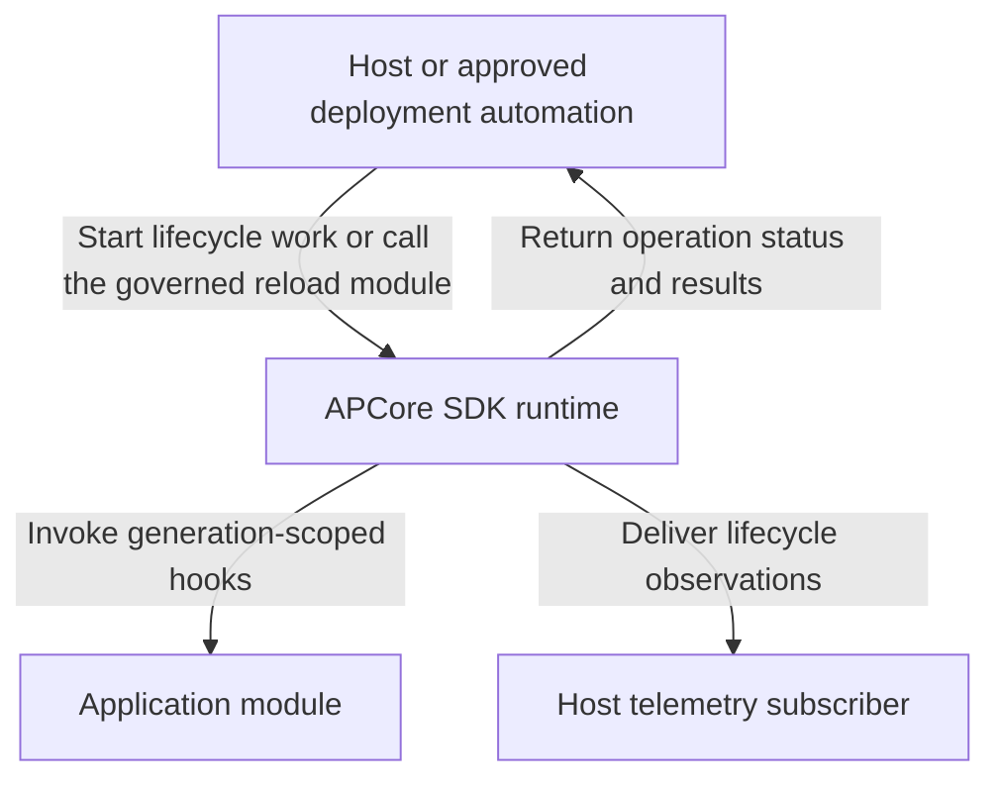
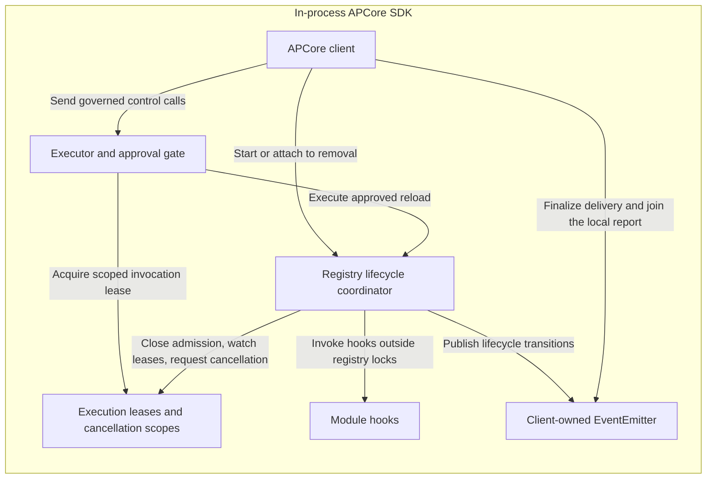
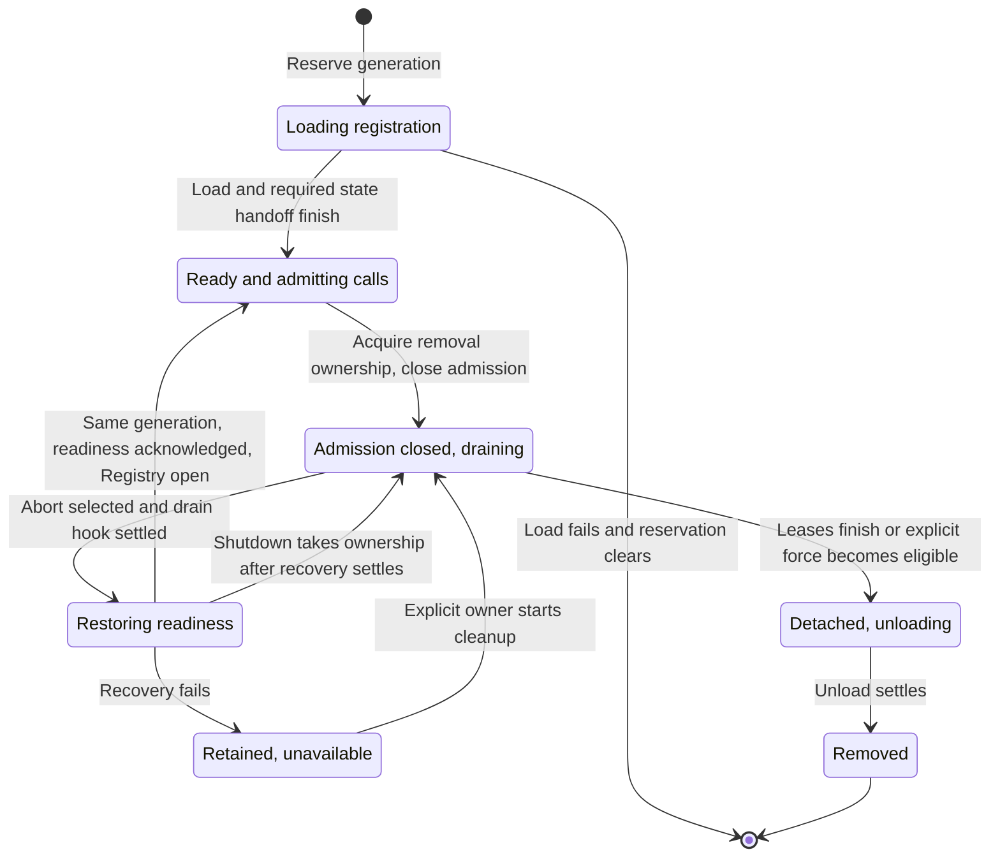

# Technical Design Document for APCore Module Lifecycle

| Field | Value |
|---|---|
| Status | Phases A and B implemented and verified in Python, TypeScript, and Rust. See the implementation plan for verification results. |
| Date | 2026-11-26 |
| Scope | Python, TypeScript, Rust, and shared conformance |
| Basis | Lifecycle audit and host shutdown, timeout, and hook design discussion |

## Overview

The host needs to stop safely within its own waiting budget, replace stateful modules without disrupting unrelated calls, and inspect the outcome even when event delivery is disabled. A Registry can outlive a client, and a module ID can name different registrations over time. The design binds lifecycle work to the owning Registry and registration generation. Hosts wait on an operation independently of the task that drives it.

The proposal extends the [client contract](../../docs/features/apcore-client.md), [Registry](../../docs/features/registry-system.md), [module interface](../../docs/features/module-interface.md), and [system module contract](../../docs/features/system-modules.md). It follows D-80 for Registry callbacks, D-112 for compensating reload, D-122 for independently owned task managers, and D-123 for publication after initialization. See the [decision register](../../docs/spec/decision-register.md).

### Goals and design inputs

- Give the host separate controls for waiting, per-module draining, batch execution, and event delivery.
- Keep in-progress operations observable after cancellation of a waiter. Keep cleanup ownership stable under repeated lifecycle requests.
- Give modules a paired drain and recovery extension. Preserve the four existing resource and state hooks, with an opt-in asynchronous path for I/O.
- Expose deterministic reports and reusable lifecycle observations without coupling cleanup to an event subscriber.
- Preserve existing callable signatures, return types, and default behavior for callers using existing entry points. Use the same SDK-native mechanism for direct and streamed execution leases.

Scope includes explicit unregistration, ordered batches, APCore shutdown, governed hot reload, and watcher integration. Hosts retain ownership of transports, schedulers, and their own task managers. Runtime state is process-local. Durable jobs, transport APIs, and cross-process coordination belong to their respective owners. [Project scope](../../SCOPE.md)

### User scenarios

| ID | Consumer | Type | Workflow | Success condition |
|---|---|---|---|---|
| US-01 | Host embedding APCore | Human | Start shutdown, wait with a short budget, and rejoin after a held call ends. | The same operation reaches a final report and each registration unloads once. |
| US-02 | Stateful module author | Human | Start a long stream, let a governed reload request drain it, and reopen the stream on the replacement. | State includes the old stream's final work, and replacement publication follows restoration. |
| US-03 | Approved deployment automation | Agent | Request a reload through the Executor, read its structured result, and decide whether to retry. | An abort identifies the affected module and old registration readiness without relying on event delivery. |

### Acceptance and success criteria

| ID | Priority | Observable requirement | Scenario | Verification |
|---|---|---|---|---|
| AC-001 | P0 | A timed-out waiter receives a pending snapshot while its host operation progresses and can be rejoined by ID. | US-01 | Shared shutdown waiter case |
| AC-002 | P0 | Two clients sharing a Registry produce one unload per loaded instance while observing their own event-delivery outcomes. | US-01 | Shared shutdown ownership case |
| AC-003 | P0 | A short waiter leaves drain policy untouched. A batch operation deadline prevents starting subsequent entries. | US-01 | Shared budget cases |
| AC-004 | P0 | Drain notification lets a stream finish before suspension or resource cleanup. | US-02 | Shared live-stream case |
| AC-005 | P0 | Aborted replacement reopens the same generation only after recovery succeeds. A recovery failure leaves it closed. | US-02 | Shared recovery cases |
| AC-006 | P0 | A failing replacement remains invisible during asynchronous load, and compensation follows D-112. | US-02 | Shared publication case |
| AC-007 | P0 | Forced cancellation targets only the retiring generation's invocation scopes and tracks late cleanup. | US-01, US-02 | Shared cancellation case |
| AC-008 | P0 | Unapproved reload requests leave admission and state unchanged. Existing wire responses retain their shapes and codes. | US-03 | Governed reload integration and Schema validation |
| AC-009 | P1 | Reports work with events disabled, while enabled notifications correlate to the operation and contain redacted fields. | US-01, US-03 | Shared event-enabled and event-disabled cases |

Release gates require all proposed P0 cases to pass in all three SDKs, one unload per loaded instance in concurrency tests, and zero lifecycle notifications for rejected governance requests. Track the timing from closed admission to final resource cleanup and count forced removals and recovery failures so operators can assess their selected budgets. The implementation PR records before and after results for the ordinary invocation fast path.

## Solution and alternatives

| Approach | Benefits | Costs and limits |
|---|---|---|
| Registry-owned coordinator with handles | Waiters come and go independently. One owner orders draining, hooks, and publication for each generation. Detailed results follow a stable operation ID. | Adds in-memory state and requires explicit ownership of active work after a waiter exits. |
| Caller-driven shutdown and reload with mandatory awaiting | Fewer lifecycle states and no long-lived driver. | Dropping the initiating future can strand partially completed work. Each host must own resumability. |
| Host-managed orchestration through Registry callbacks | Lets integrators choose operation order without expanding client APIs. | Every host has to coordinate generation ownership, acquire/release races, and asynchronous finalizers. Registry callbacks are observation points. |

Use the Registry-owned coordinator and local runtime primitives. This closes the waiter cancellation gap at the layer that owns admission and leases. An isolated worker is needed only for blocking work or independent progress. Runtime liveness remains a host dependency. The design requires no new SDK dependency.

## Architecture

### Component overview

| Component | Ownership and reuse |
|---|---|
| Registry and execution leases | Own admission, registration generations, in-progress removal, replacement publications, and the shared shutdown operation. Build on existing generation and lease tracking. |
| APCore client | Owns the wait interface and combines shared Registry progress with client-owned event-delivery progress. |
| Executor | Owns authorization, approval, and per-invocation cancellation. Attach its derived cancellation scope to the acquired generation for unary and stream execution. Unrelated generations retain their scopes. |
| Module implementation | Owns its resources, cooperative drain notification, migration hooks, and readiness when recovering from an abandoned drain. |
| EventEmitter | Provides asynchronous observations. The coordination state and reports are available independently of subscriber delivery. |

Python starts coordination from a running asyncio loop and drives Phase A cleanup on an SDK-owned worker whose lifetime is independent of the initiating loop and its default executor. The operation stores thread-safe state. Each `wait()` registers an independent future on the current loop under the same lock used to publish completion. Completion schedules notification with `loop.call_soon_threadsafe()`. Cancellation detaches only that waiter. If the loop closes before notification is scheduled, discard that notification and keep the shared result. A host can leave one `asyncio.run()` and rejoin from another while the worker is alive.

Phase B executes async hooks on the live event loop selected when the module is registered through the async adapter. Waiters may use other loops. The host keeps the hook loop available while those hooks may run. If it becomes unavailable, report the affected stage as failed and keep admission closed where readiness or teardown cannot be confirmed. TypeScript uses one owned Promise per operation and independent waiter timers. Rust uses an owned Tokio task with shared state for waiters. Validate that scheduling is available before acquiring operation ownership or closing admission. The runtime baselines are documented in the SDK manifests.

## Detailed design

### Operation ownership and timeout rules

| Field | Applies to | Default and effect |
|---|---|---|
| `wait_timeout_ms` | Each call to `wait` | Omit to await a terminal report. Zero returns a snapshot. Expiry returns the latest report and leaves the operation progressing. |
| `drain_timeout_ms` | Each generation owned by the operation | 5,000 ms for the proposed interfaces. The clock starts when the owner begins that generation's drain phase. Admission is closed at or before that boundary. Expiry records the drain deadline breach and selects the configured action. |
| `operation_timeout_ms` | Ordered explicit unregistration batch | Omit for an unrestricted batch. Expiry prevents starting further entries and reports those entries as `not_started`. An entry already started reaches a safe completion or remains tracked by the operation. |
| `event_flush_timeout_ms` | Client-owned shutdown event delivery | 5,000 ms for the whole delivery stage. Zero seals the emitter and samples outstanding work immediately. Expiry records `timeout` if delivery remains outstanding. Translate zero at the new adapter boundary to preserve native emitter timeout conventions. |
| `cancel_grace_ms` | Only `cancel_then_force` | 1,000 ms after cancellation is requested. At expiry the forced policy permits cleanup with residual invocations recorded. Zero makes the grace period immediate. |

New durations are integers in the range 0 through 2,147,483,647 ms so Node timers can represent the full range. Reject booleans, fractional values, strings, negative values, overflow, and unknown options with `GENERAL_INVALID_INPUT`. Omission selects a default. Python `None` or Rust `None` denotes omission for the optional wait and operation budgets. TypeScript omission or `undefined` denotes omission. Use monotonic clocks and absolute internal deadlines. Wall clocks are used only for event timestamps. Existing duration methods retain their own input conventions.

For a batch, the effective admission-to-action deadline is the earlier of its per-generation drain deadline and its explicit operation deadline. For example, an entry with a 5,000 ms per-generation limit and 2,000 ms left in the batch has 2,000 ms to drain. An already-started entry still completes its selected policy, including any cancellation grace and asynchronous cleanup. Check the operation deadline before acquiring ownership of each entry and stop dispatch at or after that deadline. When deciding a drain outcome, a settled hook and zero remaining leases take precedence over an elapsed timer at the ownership check. The waiter budget bounds the caller's wait. Shutdown owns already-closed admission until cleanup finishes, and its options omit the batch operation deadline.

Use these policies for new interfaces:

| Policy | At drain deadline | Eligible scope |
|---|---|---|
| `continue_waiting` | Keep admission closed. Record the deadline breach, then wait for the real leases to end. | Shutdown and unregister default, optional reload |
| `abort_reload` | Run same-generation readiness recovery while admission remains closed. | Governed reload default when the caller opts in |
| `cancel_then_force` | Request cooperative cancellation on the retiring generation's derived invocation scopes. Allow normal cleanup after all leases end, or apply forced removal after the grace period. | Explicit, trusted-host shutdown or unregister policy |

With `continue_waiting`, `drain_timeout_ms` sets the threshold for reporting the deadline breach, emitting its timeout observation when enabled, and signalling a still-running drain hook. Unload becomes eligible after the hook settles and the leases end, even when those conditions take longer than the configured threshold.

A call whose cancellation signal was sent can keep running. Hold its lease and follow its body and asynchronous finalizers until they settle. If forced removal has been selected, record the aggregate residual count at forced unload and follow late finalization through the retiring generation. Publish its resource-teardown disposition when the unload hook settles. The operation remains pending while owned finalizers run. Under `continue_waiting`, or when uncooperative work survives force, finality depends on the work settling. The process and host scheduler must stay alive to observe background progress.

### Shutdown and ordered batch

Validation precedes state mutation. One Registry operation starts shutdown, closes admission, and stops discovery and watchers. It coordinates with loading reservations and existing removals. Once closed, no generation can regain admission. Existing in-progress removal continues under its owner and shutdown joins it. The shutdown owner processes remaining generations exactly once, preserving any dependency ordering established by the Registry. An APCore client wraps that shared operation with its own emitter stage. Publish Registry resource progress before starting emitter finalization.

The first valid Registry shutdown policy wins. A later call that omits policy joins it, an equal explicit Registry policy joins it, and a different explicit Registry policy yields `GENERAL_INVALID_INPUT` naming the conflict. The first flush policy wins within each client under the same rules. A client's omitted fields inherit its active policy when joining. Leaving a wait cannot change the policy. Hook failures are recorded in the final report and remaining modules are still attempted. Rejoining returns progress or the stored final result. An explicit recovery action starts from known unfinished work and preserves the fact that an unload has already been invoked for a generation.

Legacy calls select their existing policy when starting the operation. Legacy calls that find an assigned owner join it under that owner's policy. Repeated TypeScript numeric `shutdown(timeoutMs)` calls keep their current join behavior. Explicit-policy conflict checks apply to the new options interface.

An explicit batch snapshots the validated IDs and their current generation identities in caller order. The coordinator starts each entry after the prior entry settles. Duplicate IDs are accepted and each input gets its own report row. A missing or already removed generation is `absent`. A concurrent removal owner for the same generation is `already_removing`. An empty list yields an immediately completed report. Until an entry starts, the module retains its current admission state. At dispatch, confirm the snapshotted generation before closing admission. A later registration of the same ID remains outside this batch.

In SDKs with concurrent loaded versions, admission and removal ownership cover the ID's registration set. Track each invocation against its resolved instance and the set's generation. Gather cancellation scopes across the versions being retired. Run drain, recovery, and unload at most once per affected loaded instance in an operation. Keep state handoff on the primary instance as in the current reload paths. Admission for the retained set reopens only after every participating instance acknowledges readiness.

Define an explicit same-operation wait guard for hooks, in-line callbacks, and shutdown-event subscribers whose delivery the operation is flushing. These callbacks may take a snapshot. A blocking wait on an operation that depends on the caller's callback returns `GENERAL_INVALID_INPUT` with the diagnostic `A lifecycle callback cannot wait for its own operation`. Run hooks and cancellation callbacks outside registry locks. An unrelated registration remains possible during a still-open Registry operation.

### Registration state and hot reload

When a managed removal closes admission for a generation, send `on_drain` once for its operation. The drain hook runs while old invocations may still hold resources. A successful drain requires hook settlement and release of execution leases. For reload, a drain-hook failure selects abort with `drain_error`. An elapsed deadline under `abort_reload` selects `drain_timeout`. Latch the first abort reason under the operation owner. If the same decision observes both conditions for the first time, choose `drain_error`. For unregister or shutdown, record hook failure and continue under the removal policy.

If the deadline expires while the hook is still active, signal its cooperative hook token and keep the operation `pending` in `draining`, with the drain hook reported as active. Enter `recovering` only after the drain hook settles. Recovery, suspension, unload, and publication must wait while the drain hook can still use the registration's resources. A hook that never returns leaves the operation pending and admission closed. A shutdown request during recovery closes Registry admission permanently and joins that recovery before taking over cleanup.

Run `on_drain_aborted` with admission closed when reload aborts. A module without a drain hook can regain admission directly after the ownership and Registry checks. A module that provides a drain hook must supply its paired recovery hook for managed reload, including when the chosen timeout strategy is `continue_waiting`, because the drain hook can fail under either policy. Validate that capability before closing admission. Successful recovery reuses the same generation and preserves memory state. Suspend and unload belong to the replacement path. Failed recovery reports `retained_unavailable` with the failure phase and keeps the generation available for explicit cleanup or shutdown. Any later removal still applies its own drain policy to remaining leases.

After a clean drain, invoke old `on_suspend`, then old `on_unload`. Load and optionally resume the replacement before publication. A fresh registration receives its own generation and state is transferred only when suspension returns a JSON value. Preserve the established JSON migration contract and best-effort interpretation of an `on_resume` error. Publication still waits for a terminal resume outcome. Treat a failed replacement load as D-112 compensation and rerun the old instance's `on_load` before republishing it. Report the initial failure and compensation outcome separately. The existing bulk reload still compensates per module and keeps earlier successful replacements.

State checks before detach, recovery, and publication must all verify the same generation and its operation owner. A concurrent shutdown blocks publication even if a load or resume callback eventually succeeds. The registration attempt then enters its existing failure cleanup path. Preserve the original registration error on failure. The framework owns cleanup of completed loads it declines to publish. Modules own rollback of side effects from an incomplete `on_load`.

### Module hook contract

| Phase | Required sequencing and optional extensions |
|---|---|
| Drain start | `on_drain(context)` after closing admission. It may notify ongoing module work and release resources unused by those invocations. It returns after delivering its notification. |
| Recovery | `on_drain_aborted(context)` after the drain hook settles and before reopening admission. Completion attests that the module is ready. Applies to aborted pre-unload replacement. |
| Resource management | Existing `on_load()` and `on_unload()` manage resources. Unload runs once per removed instance, including explicit forced removal. |
| State transfer | Existing `on_suspend()` and `on_resume(state)` run during replacement. No state capture after forced drain failure. Resume only receives state when capture returned a value. |

The drain context carries `operation_id`, `module_id`, reason kind (`unregister`, `reload`, `shutdown`), and a hook-scoped cancellation signal. Its monotonic remaining-time query returns nonnegative whole milliseconds until drain expiry. The recovery context carries the same operation and module identifiers, a fresh hook signal, and required `abort_reason` of `drain_timeout` or `drain_error`. Hooks may inspect lifecycle state or initiate unrelated work subject to normal governance and admission.

Only a running drain hook receives cooperative cancellation at the drain deadline. A pending load, suspend, unload, or resume remains visible in its phase until it settles. Wait expiry, the next hook, and publication each have independent gates. When shutdown supersedes an in-progress readiness recovery, it may signal that recovery and wait for settlement before cleaning up. No new API cancels a live hook by dropping its future.

| SDK | Candidate declarations for new optional hooks |
|---|---|
| Python | `def on_drain(self, context: DrainContext) -> None` and `def on_drain_aborted(self, context: DrainAbortedContext) -> None`. The opt-in adapter accepts the same signatures with `async def`. |
| TypeScript | `onDrain?(context: DrainContext): void \| Promise<void>` and `onDrainAborted?(context: DrainAbortedContext): void \| Promise<void>`. |
| Rust | The `#[async_trait]` subtrait `DrainableModule: Module` requires both `async fn on_drain(&self, context: &DrainContext) -> Result<(), ModuleError>` and `async fn on_drain_aborted(&self, context: &DrainAbortedContext) -> Result<(), ModuleError>`. |

| SDK | Existing and asynchronous hook choice |
|---|---|
| Python | Keep the synchronous names and accept `async def` for opt-in modules through the async registration adapter. Synchronous registration keeps its rejection of awaitable lifecycle hooks. Async discovery and watcher paths use the same adapter once enabled, including state restoration. |
| TypeScript | Use the existing camelCase hook names. Permit `void \| Promise<void>` for drain, recovery, load, unload, and resume, and `State \| null \| Promise<State \| null>` for suspend. Await the selected method exactly once before the next commit boundary. |
| Rust | Keep the existing synchronous signatures. The `#[async_trait]` subtrait `AsyncLifecycleModule: Module` exposes `on_load_async()` and `on_unload_async()` returning `Result<(), ModuleError>`, `on_suspend_async()` returning `Result<Option<serde_json::Value>, ModuleError>`, and `on_resume_async(state: serde_json::Value)` returning `Result<(), ModuleError>`, all with an `&self` receiver. Defaults delegate to the synchronous hooks. |

Rust `Module` exposes `fn as_drainable(&self) -> Option<&dyn DrainableModule>` and `fn as_async_lifecycle(&self) -> Option<&dyn AsyncLifecycleModule>`. Both default to `None`, following [Module.as_streaming](../../docs/features/module-interface.md#contract-moduleas_streaming). Returning `Some(self)` explicitly opts in. An exposed `DrainableModule` must implement the hook pair at compile time, and the Registry uses the same typed accessor for validation and dispatch. An implementation that leaves its accessor at `None` exposes only the base behavior. If `as_async_lifecycle()` returns `Some`, synchronous registration rejects the module before invoking hooks. Drain-only modules may use synchronous registration because managed removal already runs through the coordinator.

The asynchronous entry points use the same schema, duplication, governance, and publication sequence as synchronous entry points. The registration records its selected hook adapter so subsequent unload and compensation continue to honor it. Python and Rust synchronous registration or discovery rejects an async-only candidate before reserving a generation. Their ordinary unregister can close admission synchronously and hand async cleanup to the coordinator. Their automatic watcher replacement applies the selected adapter end to end and validates capability before acquiring drain ownership. TypeScript continues reporting file changes for host-owned imports. A TypeScript watch notification alone does not publish a replacement or run state migration.

## Proposed API and reports

Candidate call surfaces use language-native names and no new runtime dependency. Signatures below describe the public types.

| Operation | Python | TypeScript | Rust |
|---|---|---|---|
| Start or join shutdown | `APCore.start_shutdown(*, options: ShutdownOptions \| None = None) -> LifecycleOperation` | `APCore.startShutdown(options?: ShutdownOptions): LifecycleOperation` | `APCore::start_shutdown(&self, options: Option<ShutdownOptions>) -> Result<LifecycleOperation, ModuleError>` |
| Start batch, including one ID | `APCore.start_unregister_many(module_ids: Iterable[str], *, options: UnregisterOptions \| None = None) -> LifecycleOperation` | `APCore.startUnregisterMany(moduleIds: Iterable<string>, options?: UnregisterOptions): LifecycleOperation` | `APCore::start_unregister_many<I, S>(&self, ids: I, options: Option<UnregisterOptions>) -> Result<LifecycleOperation, ModuleError>` where `I: IntoIterator<Item=S>`, `S: AsRef<str>` |
| Inspect or wait | `operation.snapshot() -> LifecycleReport` and `async operation.wait(*, wait_timeout_ms: int \| None = None) -> LifecycleReport` | `operation.snapshot(): LifecycleReport` and `operation.wait(waitTimeoutMs?: number, signal?: AbortSignal): Promise<LifecycleReport>` | `operation.snapshot(&self) -> LifecycleReport` and `operation.wait(&self, wait_timeout_ms: Option<u32>) -> Result<LifecycleReport, ModuleError>` as an async method |
| Register an async-capable module | `async APCore.register_async(module_id: str, module_obj: Module) -> None` and `async APCore.register_many_async(entries: Iterable[tuple[str, Module]]) -> None` | Existing awaitable `APCore.register(moduleId, module)` and `APCore.registerMany(entries)` | Async `APCore::register_async(&self, module_id: &str, module: Box<dyn Module>) -> Result<(), ModuleError>` and async `APCore::register_many_async<I, S>(&self, entries: I) -> Result<(), ModuleError>` where `I: IntoIterator<Item=(S, Box<dyn Module>)>`, `S: AsRef<str>` |

`ShutdownOptions` accepts `drain_timeout_ms`, `on_drain_timeout`, `event_flush_timeout_ms`, and `cancel_grace_ms`. `UnregisterOptions` accepts `drain_timeout_ms`, `on_drain_timeout`, `operation_timeout_ms`, and `cancel_grace_ms`. TypeScript maps SDK fields into camelCase. Reject an explicit cancellation grace without the force policy with `GENERAL_INVALID_INPUT`. A start call performs synchronous input validation and returns after the operation is owned. Client implementations expose the same in-process result model. A timed-out snapshot may contain `pending` even when the user-supplied clock has expired. Surface deterministic state rather than timer scheduling order at an exact tie.

Expose the same batch and async registration signatures on Registry in each SDK. APCore delegates to its Registry, so standalone Registry users obtain the same operation handle and results without a client. A stand-alone batch reports `event_flush: not_applicable`.

### Report shape and outcomes

| Field | Type and semantics |
|---|---|
| `operation_id` | Opaque non-empty string stable for the operation lifetime, used to correlate a handle and events. |
| `kind` | `shutdown`, `unregister_many`, or `reload`. |
| `status` | `pending`, `completed`, or `failed`. Remain pending until owned hooks, finalizers, and the configured emitter stage reach their specified outcomes. Report failed when an owned module reaches an error, an opted-in replacement aborts, or a batch deadline prevents dispatching every entry. Event flush timeout is an independent delivery outcome. |
| `modules` | Ordered snapshots of module reports. Batch rows are indexed by input position. Reload and shutdown use the coordinator's established traversal order. |
| `stop_reason` | Optional value `operation_deadline` when the batch stops early. The corresponding entries carry `not_started`. |
| `event_flush` | `not_applicable`, `pending`, `completed`, or `timeout`. Completion means the emitter completed its delivery attempts and bounded failure handling. Deadline expiry can end the stage with work outstanding. Phase B observability can add stage-scoped counters for successful delivery, retry exhaustion, and outstanding work. |
| `error` | Optional structured primary error containing code and phase. Module outcomes retain their own phase and code for diagnostics. |

A module report carries `module_id`, `phase` (`pending`, `draining`, `recovering`, `unloading`, `loading`, `resuming`, `done`), and a terminal outcome where available. The outcomes are `removed`, `forced_removed`, `absent`, `already_removing`, `not_started`, `retained_ready`, `retained_unavailable`, `reloaded`, and `failed`. Include `active_hook` while a lifecycle hook runs, `drain_timed_out` for a drain deadline breach, and `abort_reason` when reload abort is selected. For forced removal, include `active_at_unload` and `cleanup_pending` so the result distinguishes teardown from settlement of remaining executions. Keep status snapshots immutable. On detailed reload failure, a module report also includes compensation as `not_required`, `restored`, or `failed`, and carries the primary replacement error separately.

### Governance and failure behavior

| Condition | Proposed result or error |
|---|---|
| Invalid input, unknown option, conflicting shutdown policy, or unavailable scheduler at start | `GENERAL_INVALID_INPUT` for host options and runtime policy checks. Malformed wire options rejected by the Executor's schema use `SCHEMA_VALIDATION_ERROR`. Both precede mutation. |
| Same-operation wait from a callback | `GENERAL_INVALID_INPUT` immediately in the callback. The existing operation continues after the callback settles. |
| Register while closing or register async-only module through a synchronous entry | Existing closed-Registry error. An unsupported lifecycle capability produces `MODULE_LOAD_ERROR` with its stage. |
| Exact reload selector is absent | Existing `MODULE_NOT_FOUND`. |
| Reload selectors conflict | Existing `MODULE_RELOAD_CONFLICT`. |
| Managed reload selects a loaded module exposing a drain hook without the paired recovery hook | `GENERAL_INVALID_INPUT` with the affected `module_id`. Validate every selected registration before closing admission. At dispatch, verify the validated generation still owns that ID. A changed generation yields a failed report entry with `MODULE_RELOAD_CONFLICT` and keeps the replacement's admission unchanged. |
| Governance denies or withholds approval | Preserve the existing pipeline error. No lifecycle operation exists for the rejected request. |
| An accepted reload aborts or its replacement or readiness recovery fails | Legacy replacement failures raise `RELOAD_FAILED` as today. The opt-in route returns a normal output with `success: false` and a `lifecycle_report` carrying the phase and outcome, plus the primary error and compensation result when applicable. |
| Explicit force sends cancellation | In-flight calls observing it normally report `EXECUTION_CANCELLED`. A completed call keeps its original result. |
| Wait timeout | Return a snapshot. Deadline expiry is represented in the report rather than a generic module error. |

The `lifecycle` input object accepts `drain_timeout_ms` and `on_drain_timeout` with `abort_reload` or `continue_waiting`. Its presence opts into a normal output carrying `lifecycle_report`. The closed [output Schema](../../schemas/sys-control-reload-module.schema.json) and the embedded SDK schemas accept that field and validate the report. For a single target, retain its string `module_id`. For a bulk request, attempt each selected target and retain `module_id: null`. List the successful replacements in `reloaded_modules`. Set `success: true` when all targets are successfully replaced or the selector matches nothing. Existing selector, self-protection, and governance errors retain their codes before any drain. Legacy clients omit the object and receive their existing response and error behavior.

The normal opt-in output goes through output validation and the middleware success path, including when `success` is false. Usage records a successful invocation. ErrorHistory and PlatformNotify's error-path threshold check run for invocation errors. Consumers use the report and lifecycle events to observe replacement failures. The legacy `RELOAD_FAILED` exception retains its existing retry metadata. Opt-in callers should use the report to decide whether to retry, including any entries that already succeeded. [Default retry metadata](../../docs/features/error-system.md#default-retryable)

The Executor owns the per-call timeout. After admission changes, the operation continues independently of the wire caller's wait. That call receives a detailed response only if the managed operation finishes in time. Phase B provides wire correlation through lifecycle events when enabled and leaves operation lookup off the wire surface. Trusted hosts configure watcher drain policy on watcher creation.

Requests still pass through ACL, approval, schema validation, and the existing system module. Trusted in-process callers own local shutdown and unregister policy. Force is a host capability and the proposed governed wire option offers only graceful strategies. Event data follows APCore redaction policy. Keep user inputs, migration state, hook exception text, stack traces, and tokens out of the report's public error summary and event payload.

## Observability

Use canonical EventEmitter events. D-80 still binds the current Registry callback set. The following event types and payload fields are candidates for the protocol review.

| Event | Emitted after | Additional data |
|---|---|---|
| `apcore.registry.module_drain_started` | Generation admission closes | `reason_kind`, `drain_timeout_ms` |
| `apcore.registry.module_drain_timed_out` | Drain deadline wins | `reason_kind`, `action`, `active_count` |
| `apcore.registry.module_drain_recovered` | Readiness recovery reaches a disposition | `abort_reason`, `outcome` of `retained_ready` or `retained_unavailable` |
| `apcore.registry.module_reload_failed` | Replacement and applicable compensation finish | `phase`, `error_code`, `compensation` |
| `apcore.client.shutdown_resources_completed` | A participating client observes settled Registry teardown, before it seals its owned emitter | `registry_outcome`, `forced_count`, `failure_count` |

Every event carries `operation_id` in data. Module events use the existing event envelope's `module_id` and a stable outcome severity. Emit start and successful recovery at info, timeout at warn, and failed readiness or replacement at error. Generate each Registry transition event once at its coordinator boundary. The Registry owns `apcore.registry.module_reload_failed` for both watcher and governed replacement. The control module continues to emit `apcore.module.reloaded` on success. This follows the canonical directory's use of the emitting subsystem to name new events and preserves the existing success name.

The proposed `apcore.client.*` namespace requires review in §9.16.2. Each participating client emits its shutdown resources event once per shared Registry operation to its own enabled emitter before sealing it. Repeat waits and repeat starts on that client reuse the same emitter stage. The event describes resource teardown and carries the shared Registry operation ID. Each client report records its own final emitter outcome. Delivery retains normal retry and failure handling. Event-disabled and saturated emitter paths still update report state. [Canonical event directory](../../docs/spec/protocol-spec.md#9162-canonical-core-event-types) · [Event delivery semantics](../../docs/features/event-system.md#delivery-semantics)

## Compatibility and rollout

| Existing path | Compatibility rule |
|---|---|
| `unregister`, `safe_unregister`, and `unregister_many` | Keep existing signatures, return values, and per-SDK defaults. Ordinary `unregister` continues to close admission with lease-based cleanup and no implicit force timer. |
| Python and Rust `shutdown()`, TypeScript `shutdown(timeoutMs?)` | Keep existing returns and default timeouts through compatibility adapters. The named start interface provides new policies and observation. |
| Existing synchronous modules | Run the established hooks and load checks through their current APIs. Install async behavior only through the capability-aware path. |
| Reload and watchers | Keep the existing wire contract, A25 matching, governance order, compensation, and default force policy when the request omits `lifecycle`. Updated watcher options use the owning SDK's current discovery model. |
| Context cancellation and task manager | Preserve caller scope ownership, invocation deadlines, and D-122. Host-owned task managers remain independently managed. |
| Events and conformance | Add canonical events and shared cases with corresponding SDK drivers. Keep all current event IDs and fixtures executable. |

Phase A adds Registry-owned shutdown and detailed batch operations, wait isolation, conflict handling, and diagnostics. The additive host interface initially accepts `continue_waiting`, and the compatibility adapters retain their established policies. Phase B adds module drain and recovery, async lifecycle adapters, `cancel_then_force` with scoped cancellation, governed reload reporting, and canonical events. Gate each phase on its shared cases across all three SDKs. Gate wire adoption on compatibility tests and maintainer approval. The public feature docs, decision register, protocol header/history, applicable schemas, CHANGELOG, and driver inventory are updated together with approved contract changes. Use the existing protocol version classification and issue-before-PR rules. [Repository change checklist](../../AGENTS.md#updating-docsspecprotocol-specmd)

## Shared conformance assertions

Use gate-controlled modules, distinct generation labels, a controllable deadline facility where available, and observable checkpoints on normal public entry points. Fixture expectations name ordered transitions and results. Avoid comparing wall-clock sleeps or subscriber delivery order. Extend the existing [module lifecycle fixture](../../conformance/fixtures/module_lifecycle.json) and its three drivers when implementing each phase.

| Proposed fixture case | Arrange and assert |
|---|---|
| `shutdown_waiter_expires` | Hold a call after lease acquisition. Start shutdown and observe `pending` with the module in `draining`. Run both waiter cancellation and deadline expiry variants. Release the call after the first waiter leaves. Observe the unload hook's signal before rejoining, then assert `completed`, the original operation ID, one `removed` row, `MODULE_NOT_FOUND` on new calls, and one unload. |
| `shutdown_concurrent_once` | Start from two clients sharing a Registry. Assert identical Registry operation IDs, two `completed` reports with the same `removed` rows and one unload per generation, different client-owned flush outcomes, and `GENERAL_INVALID_INPUT` for conflicting explicit Registry options. Once Phase B events are enabled, assert one shutdown resources event on each owned emitter with the shared ID. Repeat starts or waits on one client leave both event counts unchanged. |
| `drain_signal_finishes_stream` | Open a stream whose final work waits for the drain signal. Start governed reload. Assert `drain` → `finish` → `suspend` → `unload` → `load` → `resume` before the replacement returns the transferred final state. |
| `reload_abort_retains_ready` | Hold an old lease past the drain deadline and gate the recovery hook. Assert `MODULE_NOT_FOUND` on new calls while recovery is pending. After recovery, assert `success: false`, `retained_ready`, and the old instance's retained state on a new call. Assert the only old hooks called were `drain` and `drain_aborted`, with zero replacement events. |
| `reload_drain_hook_stalls` | Hold the drain hook past the deadline and observe its cancellation signal. The reload call stays pending, Registry reports the module is draining, and a new call returns `MODULE_NOT_FOUND`. Recovery and unload counts remain zero while the hook is held. Release it and assert one recovery with `drain_timeout` and a normal output containing `success: false` and `retained_ready`. |
| `reload_drain_hook_fails` | Make the drain hook fail before its deadline. Assert one recovery with `drain_error` and a normal output containing `success: false` and `retained_ready`. Suspend, unload, and replacement load counts stay zero. |
| `replacement_load_failure_invisible` | Gate the replacement load and assert lookup fails with `MODULE_NOT_FOUND`. Release it with a test `MODULE_LOAD_ERROR` and gate compensation load. Assert the failed replacement was never visible and the restored original appears only after compensation load. Assert `success: false`, `failed`, and compensation `restored` with the original error code. |
| `force_cancels_only_retiring_scope` | Hold two invocations derived from one caller context, one on an unrelated generation. Select force for one generation and advance the deadline. Assert only its token receives cancellation, preserve the unrelated result and parent token, and assert its late completion has no effect on the next registration's leases. |
| `reload_abort_recovery_failure` | Fail the recovery hook. Assert `retained_unavailable`, closed admission, preserved generation, and no implicit second load. Start host shutdown and observe one resource cleanup. |
| `batch_wait_budget_independent` | Hold the first of two entries. Expire a short waiter before the first drain limit and assert the second remains `pending`, with normal admission. Expire the separate explicit operation budget, release the first entry, and assert final `failed` with `stop_reason: operation_deadline`. The second entry is `not_started` and remains callable. |
| `continue_waiting_after_drain_deadline` | Hold an invocation during the new default shutdown and advance past 5,000 ms. Assert `drain_timed_out`, pending shutdown, no invocation cancellation, and zero unloads. Release it and assert the original success and one normal unload. |
| `shutdown_hook_self_wait` | Have a drain or unload hook observe its operation and try to wait on it. Assert that snapshot works, same-operation wait returns an invalid-input error, and other modules still reach their terminal outcomes. |
| `lifecycle_events_optional` | Run once without an emitter and once with a gated subscriber. Report module outcomes in both runs. Assert operation IDs on emitted events, no sensitive input or state fields, and an event flush timeout when the subscriber holds a delivery. |
| `shutdown_wins_reload_recovery` | Hold an aborted reload's recovery hook, start shutdown from a second client sharing the Registry, then release recovery. Assert the old generation stays closed and only shutdown unloads it. |
| `multi_version_shutdown` | In SDKs that load multiple versions at once, hold work on an old version and start shutdown. Assert one unload for each loaded instance and a single removal outcome for the ID. Run the same ownership assertion with a single loaded instance in TypeScript. |

SDK-local tests cover invalid and boundary duration values, late cancellation callbacks, async hook selection, source watcher ownership, saturation, and cancellation of the Rust driver runtime. In Python, time out a waiter in one `asyncio.run()`, close that loop with cleanup still pending, and await the same operation from a second `asyncio.run()`. Assert one unload and a stable operation ID. Rust consumer compilation covers missing `DrainableModule` methods. Python and TypeScript integration tests cover rejection of a missing recovery hook before any admission change. All SDKs verify that the opted-in normal error outcome follows the middleware success path while the same legacy failure raises `RELOAD_FAILED`. TypeScript's notify-only watcher test holds re-import and checks publication and hook counts stay unchanged until the host acts. Extend the existing self-control cases with the opt-in object and verify identical rejection before drain.

Continue running governance, cancellation, streaming, Registry, and lifecycle fixtures. Ordinary calls should allocate lifecycle tracking only for work they already lease. Compare equivalent before and after public call microbenchmarks using each SDK's runtime and report the median over repeated runs. A proposed launch threshold is no repeatable regression above 5% in ordinary call latency or steady-state allocations.

## Review decisions

| Decision | Recommendation and evidence to close |
|---|---|
| Public API names and report vocabulary | Adopt additive start and wait methods. Confirm package naming and source compatibility by compiling sync and async consumers in each SDK before approval. |
| Governed wire opt-in | Validate the normal `success: false` output and legacy exception path against middleware accounting, canonical schemas, and adapter consumers. Approve the proposed event names and their emitting owners with §9.16.2. |
| Recovery and runtime interruption | Keep admission closed after failed readiness. Validate the hook pair, cross-loop Python waits, compensating cleanup, and watcher behavior under waiter cancellation. |
| Timing limits | Ship deterministic policy defaults and a portable integer range. Measure short budgets and pending cleanup with fake clocks and explicit gates before deciding optional tuning. |
