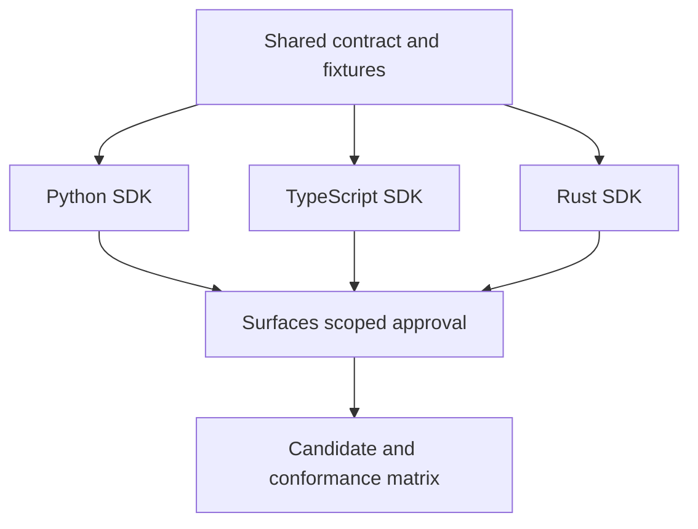

# Post-validation Policy Implementation Plan

Status: proposed. Maintainer approval is pending for the approval timing and protocol draft revision. This plan records the proposed behavior and test gates.

## Goal

Let an explicitly configured host policy evaluate the validated inputs that a module will execute and authorize any resulting approval against that invocation across Python, TypeScript, Rust, and the affected Surfaces adapters.

## Architecture Design

1. Resolve the module and snapshot its actual descriptor version from the registration or execution lease selected at Step 3. Keep the existing ACL decision at Step 4. An ACL denial ends the request before giving the policy evaluator access to arguments.
2. In the default assembly, Step 5 retains its existing timing and compatibility behavior. In an assembly with a `PolicyEvaluator`, Step 5 computes the existing approval requirement from module and declared annotations, execution policy, and ACL. A known approval requirement with strict policy and no handler still rejects before middleware. Before middleware performs trusted, side-effect-free input normalization for this assembly. Step 7 validates its output. The existing ACL evaluates submitted arguments, and the evaluator receives the validated view.
3. Step 7.5 runs the installed evaluator on a detached view of the effective inputs. It merges `require_approval` with the Step 5 requirement. A deny verdict or evaluation failure stops the invocation. The required approval is requested or resumed once for the final invocation, with the credential scoped to principal, `caller_id`, `module_id`, resolved module version, and canonical argument digest. The credential stays in the existing private pipeline slot until the enforcing gate consumes it.
4. The invocation binds the evaluation and approval to an owned snapshot. The built-in execute and stream producer entry points dispatch the covered snapshot. A configured strategy that cannot preserve validated ordering and execution coverage is rejected. Step skips, step error recovery, and module error middleware cannot convert a policy rejection into a successful result or execute an uncovered invocation.
5. Preflight uses the same evaluator on the inputs it validates after an allowed ACL decision. It reports the combined approval requirement without invoking approval handlers, consuming credentials, or starting the module or its producer. The real invocation reevaluates after before middleware has run. Preflight discloses neither module previews nor further policy inputs after the applicable authorization check fails.

Use the existing `ExtensionManager` singleton provider pattern and the executor's existing approval and strategy wiring. `PolicyEvaluator` is a host-provided async interface. Use the existing native schema validators and `ScopedApprovalHandler` contract with MCP's transactional `consume_scoped` operation. The Core registry remains independent of the evaluator. The design adds no policy DSL or separate module dispatch path.

## Design Decisions

### High-Impact Decision Record: Approval timing and execution coverage

**Necessity.** A retry restarts at Step 1. Two active gates can compute different argument scopes after normalization, but only one opaque resume credential is carried. If Step 5 consumes a final-scope credential first, a valid approval may be rejected or lost. The evaluator-enabled assembly authorizes once after validation and includes the early approval requirement.

**Data characteristics.** The execution snapshot is request-local and derives from the actual registered module, effective inputs, and trusted context. Before middleware receives business inputs and serves as trusted normalization in the evaluator-enabled profile. Persisted approval records carry scope and expiry, with atomically consumable state owned by the handler.

**Volatility.** Registration replacement and argument transformations can invalidate a previously authorized scope. Capture the selected module version at lookup. A version binds the version value, so deployments that replace implementation semantics under the same version must invalidate outstanding records or advance the version. Step 7.5 is additive; the existing step IDs and standard path remain stable without an evaluator.

**Migration cost.** Hosts opt in by installing an evaluator. They must review their before middleware for side effects and assemble a strategy with the supported enforcement boundary. Existing unconfigured request handling and the legacy non-strict fallback retain their prior behavior. In the configured profile a required final approval has to be satisfiable by a handler, and an evaluator requirement cannot fall through to a non-strict default.

**External contract impact.** `PolicyEvaluationRequest` exposes effective arguments and schema-derived sensitive paths to the trusted evaluator. `ApprovalRequest` gains resolved version and enough trusted scope metadata for a handler to distinguish final-scope records. Preserve the existing handler methods and wire metadata. Check Rust `ApprovalRequest` struct literals and public enum matches when choosing the additive shape. The error contracts distinguish `POLICY_DENIED`, sanitized `POLICY_EVALUATION_ERROR`, and caller cancellation.

**Cheaper alternative.** A step that runs an evaluator after validation could coexist with two independent approval prompts, but it lacks safe resumption for the two-scope case. Moving all existing Step 5 approvals would change middleware ordering for unconfigured hosts. Use the single final gate only when a host supplies an evaluator.

### High-Impact Decision Record: Approval scope and canonical arguments

**Necessity.** A scope verifier needs stable argument equality and the actual module version. Reusing the schema content hash would apply inconsistent native number and string serialization across SDKs.

**Data characteristics.** The digest covers only an interoperable projection of the effective arguments. Evaluate RFC 8785 viability against the minimum and full profiles before selecting the encoding. RFC 8785 may serialize distinct native values identically, such as signed zero or integer and float spellings. Require a lossless projection for distinctions visible to a module and reject ambiguous, non-finite, or unsupported values in the opted-in mode when their projection cannot be proven. Keep the execution values unchanged. Privileged evaluators and existing approval handlers receive only the inputs needed by their contracts. Telemetry excludes raw arguments, credentials, digest, and backend error text.

**Volatility.** Version the scope representation independently of persisted legacy records. Fix its cross-language properties through fixture vectors for equivalent ordering, Unicode, numeric edge cases, and values that must reject. Keep the protocol on its proposed 2.0.0 line subject to the draft revision decision and repository version checklist.

**Migration cost.** Keep legacy records eligible only for the existing scope. A missing version or scope marker cannot act as a wildcard for evaluator-enabled approvals. Document reissuance where stores cannot safely upgrade outstanding records. Reuse the current atomic consume behavior so stores need no second confirmation transition.

**External contract impact.** MCP preserves its approval metadata and forwards the private credential through the existing Core invocation interface. Consumers gaining the new `ApprovalRequest` field must preserve construction compatibility where feasible. The new record scope stays inside the handler; external APIs do not receive digest fields.

**Cheaper alternative.** Native JSON equality could compare arguments in one process. It would not provide the stable approval digest expected by scoped stores and cross-SDK conformance. Validate a small interoperable domain through the existing profile gates before adding any dependency.

## Task Breakdown

| Task | Depends on | Estimate |
|---|---|---|
| [Shared contract](./tasks/shared-contract.md) | Maintainer approval | 4 hours |
| [Python](./tasks/python.md) | Shared contract | 6 hours |
| [TypeScript](./tasks/typescript.md) | Shared contract | 6 hours |
| [Rust](./tasks/rust.md) | Shared contract | 8 hours |
| [Surfaces](./tasks/surfaces.md) | Python, TypeScript, Rust | 6 hours |
| [Integration](./tasks/integration.md) | Surfaces | 4 hours |

## Risks and Considerations

- **Normalization and queued approval.** A retry can produce different defaults, middleware outputs, or a new module version. Reevaluate on retry and reject a scope mismatch without dispatch or an automatic fallback approval.
- **Pipeline escape paths.** Test the real execute and producer boundaries, including mutable values held by middleware, configured and per-call strategies, step jumps, error recovery, and timed-out evaluators.
- **Error and deadline semantics.** Bound evaluator execution by its configured limit and the invocation deadline. Return a sanitized evaluation failure when it faults or exceeds its budget. Preserve the existing result for external cancellation and keep cancellation distinct from an evaluator timeout.
- **Audit and disclosure.** Record only approved rule identifiers, decision values, and sensitive field paths in the policy event payload. Include tested safe guidance for denials and fixed diagnostics for evaluator faults. Verify logs, events, and serialized errors with sentinel sensitive values.
- **Performance and packaging.** An unconfigured host should incur no evaluator invocation or canonicalization. Compare minimal and full package imports, artifact sizes, and hot-path costs with the alpha.2 baseline. Detect native data lost by coercion rather than hashing a different invocation.

## Acceptance Criteria

| Scenario | Normal call | Preflight | Stream before producer |
|---|---|---|---|
| ACL denies or schema rejects | Evaluator, approval, and execute are untouched | Evaluator, approval, and module preview are untouched | Evaluator, approval, and producer are untouched |
| Policy denies | `POLICY_DENIED` with safe guidance and no execution | Policy check reports denial without disclosure or side effects | `POLICY_DENIED` with zero producer starts |
| Evaluator fails or exceeds its limit | `POLICY_EVALUATION_ERROR` with sanitized details and no execution | Policy check reports the same fault class | No producer starts |
| Caller cancels | Existing cancellation outcome | Existing cancellation outcome | No producer starts |
| Early and policy rules both require approval | One prompt or one scoped consumption on final inputs | Reports required approval without consulting the handler | Same one-gate behavior before producer start |
| Middleware rewrites parameters and the original request requires approval | Approval covers rewritten, validated arguments, including when the evaluator returns `allow` | Evaluates the submitted validated input without the rewrite | Approval covers the same effective arguments as a call |
| Pending resumption | Re-enters from Step 1, consumes matching token once, rejects changed version, principal, caller, module, or effective arguments | Leaves any token untouched | Same resumption guard before producer start |
| No evaluator | Existing Step 5 order, fail-closed defaults, and explicit compatibility policy | Existing reporting | Existing execution, cancellation, and completion |

- [ ] Maintainer decision recorded before normative edits. Update the specification draft revision, version-history row, and changelog together. Use a linked discussion issue before opening a spec PR.
- [ ] All three SDKs pass the shared fixtures through the public entry points. The matching scope accepts equivalent object key order and denies malformed values or replayed credentials. Disclosure probes confirm there is no provider access after failed authorization and no policy or credential leakage to diagnostics.
- [ ] MCP demonstrates pending approval and resumption against installed candidate packages, with exactly one successful execution and rejection for request changes. Existing Toolkit minimum compatibility and unaffected paths retain coverage from the normal package matrix.
- [ ] Local review and CI validate minimal and full profiles, adapter compatibility, docs builds, and package behavior. Tags and registry publication remain paused.

## References

- Atlas `apcore_architecture_evolution_blueprint.md`, Gap 1 and the later-alpha delivery stage
- [Protocol specification](../../docs/spec/protocol-spec.md#7-approval-system), approval and scoped resumption
- [Execution pipeline](../../docs/features/execution-pipeline.md), [approval system](../../docs/features/approval-system.md), and [extension system](../../docs/features/extension-system.md)
- [Conformance suite](../../conformance/README.md) and [alpha.2 delivery](../microkernel-delivery/alpha-2.md)
- [RFC 8785](https://www.rfc-editor.org/rfc/rfc8785.html), candidate canonical encoding
